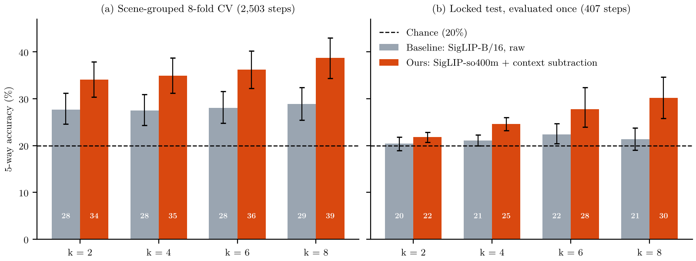
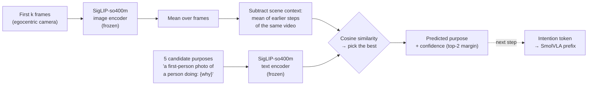

<div align="center">

# VLIA: Vision–Language–Intention–Action

### Reading a person's goal from egocentric video, so a robot can act when nobody tells it what to do

[](#roadmap)
[](#connecting-intention-to-the-robot-policy)
[](#method)
[](#results)
[](#evaluation-protocol)
[](LICENSE)

Undergraduate thesis project · VNU University of Engineering and Technology (UET), Hanoi

</div>

---

## TL;DR

Vision–language–action (VLA) robot policies such as **SmolVLA** only work when someone types an instruction. People who work next to a robot rarely say everything they intend. VLIA adds an **intention module**: from the first few frames of a first-person video, it picks out *why* the person is doing the current step, and then passes that goal to the policy in place of the missing instruction.

**Main findings so far** (each number comes from a file under [`results/`](results)):

| # | Finding | Evidence |
|:-:|---|---|
| 1 | **The VLA's own backbone does not read human goals.** A readout trained on frozen SmolVLM2 features stays near chance. | 1.13–1.19× chance MRR, and every 95% interval includes 1 ([paper](paper/main.pdf)) |
| 2 | **A training-free intention module works better.** We use SigLIP-so400m and subtract the scene context of earlier steps, with no trained parameters. | **30.2%** 5-way accuracy on a locked test run once, vs 21.4% for the SigLIP-B/16 baseline (chance 20%) ([`locked_test_final_v1`](results/locked_test_final_v1/summary.md)) |
| 3 | **The policy depends completely on the goal signal**, which motivates an intention channel. | SmolVLA on LIBERO-10 succeeds in **19/100** episodes with the correct instruction, and in **0/100** with an empty or wrong one ([`libero_goal_ablation_v1`](results/libero_goal_ablation_v1/summary.md)) |

<p align="center">
  
  <br><em>Accuracy at choosing the true purpose among 5 candidates from the same video, as a function of the number of observed frames k. Error bars are 95% video-level bootstrap intervals.</em>
</p>

---

## The problem

> **Early goal disambiguation.** Given only the first *k* ∈ {2, 4, 6, 8} frames of an egocentric manipulation step, choose the true purpose ("WHY") of that step.

The task is hard because the distractors are **other purposes from the same video**: same person, same kitchen, same objects. Here is a real example from EgoIntent (a video of kneading dough):

| Observed | Candidates (the model sees all five) |
|---|---|
| 8 frames of a hand reaching for a green basin of flour | ✅ **positioning basin** · add salt to flour · prepare to pour water into flour · clean the table surface · forming dough |

Guessing at random gets 1 in 5 right (**20%**). The dataset holds 2,503 labelled steps from 27 videos and 13 scenes (kitchen, workshop, garage, farm…). A separate set of 407 steps from 4 further videos is kept as a locked test.

### Why a VLA needs this

SmolVLA reads a prefix of tokens, `[camera images | language instruction | robot state]`, and generates an action chunk. The instruction is its **only** source of goal information. Remove it and the policy fails every time (0/100 on LIBERO-10). When a person does not say what they want, the robot has to infer the goal from what it sees, and that inferred goal has to enter the policy through the same slot.

---

## Method



1. **Encode the frames.** Each frame goes through the frozen SigLIP-so400m image encoder, which produces one 1152-d vector per frame. These vectors are averaged.
2. **Remove what all steps share.** Every step of a video happens in the same room, so raw embeddings mostly encode the scene. We subtract the mean embedding of all *earlier* steps of the same video (strictly causal), which leaves what is changing now. The first step of a video has no earlier steps, so for it we fall back to subtracting the training-set mean.
3. **Encode the candidates.** Each purpose sentence is wrapped in the template `a first-person photo of a person doing: {why}` and encoded with the SigLIP text encoder.
4. **Choose.** The model picks the candidate with the highest cosine similarity. The margin between the top two scores serves as a confidence signal, so the robot can **abstain and ask** when it is unsure.

Nothing in this module is trained. The whole configuration was **selected by nested cross-validation** from 90 training-free variants (5 image–text encoders from the SigLIP, SigLIP 2 and CLIP families × frame aggregation × context removal × text template), and the same configuration won in 8 out of 8 outer folds. It was then frozen ([`FROZEN.json`](results/frozen_pipeline_v1/FROZEN.json)) before the test split was opened.

---

## Results

### Intention module on EgoIntent

| Setting | k = 2 | k = 4 | k = 6 | k = 8 |
|---|:-:|:-:|:-:|:-:|
| Chance | 20.0 | 20.0 | 20.0 | 20.0 |
| **Cross-validation** (2,503 steps, scene-grouped 8-fold), baseline SigLIP-B/16 | 27.7 | 27.5 | 28.1 | 28.9 |
| **Cross-validation**, ours (nested selection) | **34.1** | **34.9** | **36.2** | **38.7** |
| **Locked test** (407 steps, run once), baseline | 20.4 | 21.1 | 22.4 | 21.4 |
| **Locked test**, ours (frozen) | **21.9** | **24.6** | **27.8** | **30.2** |

5-way accuracy (%). Sources: [`ladder_v1`](results/ladder_v1/summary.md), [`locked_test_final_v1`](results/locked_test_final_v1/summary.md).

On the locked test, ours beats the baseline with a paired bootstrap interval above zero at k = 4, 6 and 8 (for example +8.9 points [+4.4, +14.8] at k = 8). At k = 2 the two are not separable.

### Sanity checks and extra analyses

| Experiment | Result | What it shows |
|---|---|---|
| Frames swapped for a video from another scene (locked test, k = 8) | 31.4% → **21.6%** | Accuracy drops to chance, so the module really uses the video and not cues in the sentences |
| Answer only the 50% most confident queries (CV, k = 8) | 38.7% → **47.4%** | The confidence score is meaningful, so the robot can defer on hard cases ([`selective_frozen_v1`](results/selective_frozen_v1/summary.md)) |
| Trained readout on frozen SmolVLM2 features | 1.13–1.19× chance MRR, intervals include 1 | The VLA backbone alone does not expose the goal |
| SmolVLM2 zero-shot scoring of the candidates | 23.5–24.6% | Above chance, but about 4 points below SigLIP ([`e1b_smolvlm2_v2`](results/e1b_smolvlm2_v2)) |
| SmolVLA on LIBERO-10 with correct / empty / wrong instruction | **19 / 0 / 0** out of 100 | Without a goal signal the policy does nothing useful |

### Negative results we report on purpose

- **Ranking against all purposes is not better than the baseline.** Gallery MRR, which ranks against every purpose in the dataset rather than 5 candidates, is *lower* than the baseline on the locked test at all four prefixes. Subtracting the scene context also removes the cue that tells the model which scene it is in.
- Several ideas did not help and are left out of the final pipeline: early stopping on a confidence threshold ([`ead_v1`](results/ead_v1)), a kNN cache over training queries ([`knn_cache_v1`](results/knn_cache_v1)), and gating on a hand detector ([`hoi_detection_v1`](results/hoi_detection_v1/GATE.md)).

---

## Evaluation protocol

We put a lot of care into keeping the numbers honest:

- **Pre-registration.** Grids, selection rules and pass/fail verdicts were committed *before* each experiment ran ([`prereg_v2.md`](results/prereg_v2.md), [`prereg_ladder_v1.md`](results/prereg_ladder_v1.md)).
- **Scene-grouped cross-validation.** A scene never appears in both the training and the held-out fold.
- **Nested selection.** Every configuration choice is made on training folds only.
- **Video-level bootstrap.** Confidence intervals resample whole videos (B = 10,000), not individual frames.
- **One-shot locked test.** The test split was evaluated exactly once, after the pipeline was frozen and the user approved the run explicitly. It will never be reused for model selection.
- **Controls.** Mismatched-video controls and exact chance levels are reported for every metric.

The locked test contains only 4 videos, so its intervals rest on 4 bootstrap clusters and should be read as exploratory.

---

## Connecting intention to the robot policy

VLIA extends SmolVLA ([`policies/smolvla`](policies/smolvla)) with an optional **intention token**:

```
prefix = [ image tokens | language tokens | intention token | state token ]  →  SmolVLM2 (16 layers)  →  action expert  →  50-step action chunk
```

An intention vector `z_int` (for example the 1152-d SigLIP embedding of the inferred purpose) passes through a single linear **Intention Adapter** (`d → 960`) and is inserted right after the language tokens. The feature is behind a flag (`use_intention_token`). When the flag is off, the model gives the same outputs as stock SmolVLA.

Interface tests ([`adapter_dims_v1`](results/adapter_dims_v1/summary.md)) pass for d ∈ {256, 768, 1152}: finite loss, non-zero adapter gradients, correct prefix length and token order, KV-cache inclusion, identical outputs with the flag off, and checkpoint round-trip. These tests show that the implementation is correct. They do not yet show that the robot performs better.

---

## Roadmap

- [x] Training-free intention module, selected with nested CV and frozen
- [x] One-shot locked test on EgoIntent
- [x] LIBERO-10 goal-information ablation (19 / 0 / 0)
- [x] Intention token interface for SmolVLA, with tests
- [ ] **Intention replaces instruction.** Retrain SmolVLA on LIBERO with the instruction always empty, so the goal reaches the policy only through the intention token. Success means (a) the intention-only policy clearly beats the empty instruction (0/100), and (b) the correct intention clearly beats the intention of another task.
- [ ] Improve the intention module using CV only: recency-weighted frames, fusion of scores with and without context removal, hard-negative residual adapter, and a large multimodal LLM baseline (Qwen2.5-VL)
- [ ] Evaluate on a self-recorded egocentric dataset as a new independent test ([protocol](docs/own_dataset_protocol.md))
- [ ] End to end: human video → inferred purpose → intention token → robot action

---

## Repository structure

```text
vlia-uet/
├── policies/
│   ├── smolvla/          # SmolVLA with the optional intention token (VLIA)
│   └── intention/        # Intention Adapter and earlier trained encoders
├── scripts/              # Feature extraction, CV ladder, locked test, LIBERO ablation, plots
├── results/              # Every reported number: summary.md / *.csv / INTERPRETATION.md per experiment
│   ├── frozen_pipeline_v1/   # FROZEN.json: the exact frozen configuration
│   ├── ladder_v1/            # Nested CV over 90 training-free configurations
│   ├── locked_test_final_v1/ # One-shot locked test
│   └── libero_goal_ablation_v1/
├── datasets/, config/    # Data loaders and experiment configs
├── docs/                 # Design notes, own-dataset protocol, README assets
├── thesis_v2/            # Thesis (Vietnamese, LaTeX)
├── paper/                # Conference paper draft (English, IEEEtran)
└── tests/
```

---

## Getting started

```bash
# 1. Environment
conda env create -f environment.yml        # or: pip install -r requirements.txt
conda activate vlia_uet

# 2. LeRobot (SmolVLA) from source
git clone https://github.com/huggingface/lerobot.git ~/lerobot
cd ~/lerobot && pip install -e ".[smolvla]" && cd -

# 3. Main entry points (each script documents its arguments)
python scripts/extract_ladder_embeddings.py --help   # cache SigLIP frame/text embeddings
python scripts/run_ladder_v1.py                      # nested CV over training-free pipelines
python scripts/run_selective_frozen.py               # confidence / abstention analysis
python scripts/libero_goal_ablation.py --help        # LIBERO-10 instruction ablation
python scripts/plot_readme_results.py                # regenerate the figure above
```

EgoIntent videos are not redistributed here. Download them from the original authors ([arXiv:2603.12147](https://arxiv.org/abs/2603.12147)), then point the manifest paths in the scripts to your local copy.

---

## Documents

- 📄 **Paper draft:** [*Is the VLA Backbone Enough to Read Human Goals? Early Goal Disambiguation from Egocentric Video*](paper/main.pdf)
- 📘 **Thesis** (Vietnamese): [`thesis_v2/`](thesis_v2)

## Citation

```bibtex
@misc{vlia2026,
  title  = {Is the VLA Backbone Enough to Read Human Goals? Early Goal Disambiguation from Egocentric Video},
  author = {Trang},
  year   = {2026},
  note   = {Undergraduate thesis project, VNU University of Engineering and Technology},
  url    = {https://github.com/sgdfgnhmjnfd/vlia-uet}
}
```

## Acknowledgements

This project builds on [LeRobot / SmolVLA](https://github.com/huggingface/lerobot), [SigLIP](https://huggingface.co/google/siglip-so400m-patch14-384), the [EgoIntent](https://arxiv.org/abs/2603.12147) benchmark and [LIBERO](https://libero-project.github.io/). It is supervised at the Faculty of Electronics and Telecommunications, VNU-UET.

## License

[MIT](LICENSE)
