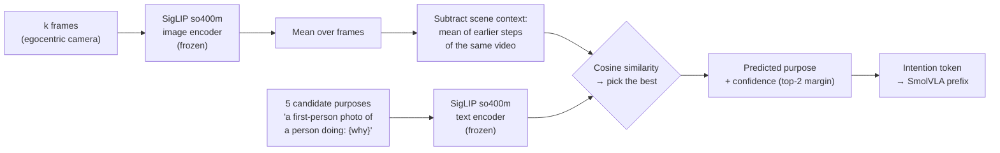

<div align="center">

# VLIA: Vision–Language–Intention–Action

### Reading a person's goal from egocentric video, so a robot can act when nobody tells it what to do

[](#results)
[](#connecting-intention-to-the-robot-policy)
[](#method)
[](#results)
[](#evaluation-protocol)
[](LICENSE)

Undergraduate thesis project · VNU University of Engineering and Technology (UET), Hanoi · Supervisor: Assoc. Prof. Hoàng Văn Xiêm

</div>

---

## TL;DR

Vision–language–action (VLA) robot policies such as **SmolVLA** only work when someone types an instruction. People who work next to a robot rarely say everything they intend. VLIA adds an **intention module**: from a few frames of a first-person video, it picks out *why* the person is doing the current step, and passes that goal to the policy through an **intention token** in place of the missing instruction.

**Main findings** (every number links to the file it comes from):

| # | Finding | Evidence |
|:-:|---|---|
| 1 | **The VLA's own backbone does not read human goals.** A readout trained on frozen SmolVLM2 features stays near chance. | 1.13–1.19× chance MRR ([`scene_cv_v1`](results/scene_cv_v1/summary.md)) |
| 2 | **A training-free module does better.** SigLIP so400m, after removing what all steps of the video share, with no trained parameters. | **30.2%** on a locked test run once, vs 21.4% for the SigLIP-B/16 baseline; chance is 20% ([`locked_test_final_v1`](results/locked_test_final_v1/summary.md)) |
| 3 | **The intention token can replace the instruction.** SmolVLA retrained with an always-empty instruction, steered only by the token. | LIBERO-10: **20/100** with the correct token vs 19/100 for the original policy with the correct instruction; 0/100 with a wrong token or an empty instruction ([`libero_intention_only_v1`](results/libero_intention_only_v1/summary.md)) |
| 4 | **For predicting what comes next, the length of the window matters, not the number of frames.** | 2 frames spread over 4 s reach **36.8%** (0.5 s ahead); 12 frames = 8 frames; windows longer than 4 s lose about 1 point ([`stage9a_frames`](results/stage9a_frames/summary.csv)) |
| 5 | **The bottleneck is recognising the current step.** Knowing the true step history, a text LLM predicts the next step well; with the history our module recognises, it does not. | NEXT step: **43.8%** with the true history vs 27.3–29.2% with the recognised one ([`lit_baselines_next`](results/lit_baselines_next/antgpt_summary.csv)); recognition is only 6.2%, and 8.3% after Qwen re-ranking ([`stage9c`](results/stage9c_qwen_recognition/recognition_summary.csv)) |

### Tóm tắt (Tiếng Việt)

Robot dùng mô hình VLA (như SmolVLA) chỉ làm được việc khi có người gõ câu lệnh. Đề tài thêm một **mô-đun ý định**: nhìn vài khung hình từ camera đeo trên đầu người, mô-đun chọn ra *mục đích* của bước người đang làm và đưa vào robot qua một **token ý định** thay cho câu lệnh. Mô-đun không cần huấn luyện (SigLIP so400m, trừ phần khung cảnh chung của các bước trước), đạt 30,2% trên tập test riêng chạy một lần, so với 21,4% của cách cơ sở (đoán mò 20%). Trên LIBERO-10, chỉ với token ý định robot thành công 20/100 lần, ngang câu lệnh đúng (19/100), còn token sai hoặc lệnh rỗng là 0/100. Khi đoán trước hành động, độ dài đoạn nhìn quyết định chứ không phải số khung; khâu yếu nhất là nhận ra bước hiện tại.

<p align="center">
  
  <br><em>Accuracy at choosing the true purpose among 5 candidates from the same video, against the number of observed frames k. Error bars are 95% video-level bootstrap intervals.</em>
</p>

---

## The problem

> **Early goal disambiguation.** Given only the first *k* ∈ {2, 4, 6, 8} frames of an egocentric manipulation step, choose the true purpose ("WHY") of that step.

The distractors are **other purposes from the same video**: same person, same room, same objects. A real example from EgoIntent (a video of kneading dough):

| Observed | Candidates (the model sees all five) |
|---|---|
| 8 frames of a hand reaching for a green basin of flour | ✅ **positioning basin** · add salt to flour · prepare to pour water into flour · clean the table surface · forming dough |

Guessing at random gets 1 in 5 right (**20%**). Scores are strict top-1: a tie counts as wrong. The development set has 2,503 labelled steps from 27 videos and 13 scenes (kitchen, workshop, garage, farm…). A separate set of 407 steps from 4 further videos is the locked test.

**Why a VLA needs this.** SmolVLA reads `[camera images | language instruction | robot state]` and outputs actions. The instruction is its only source of goal information: remove it and the policy fails every time (0/100 on LIBERO-10). If the person does not say what they want, the robot has to infer the goal from what it sees, and that goal has to enter the policy through the same place.

---

## Method



1. **Encode the frames.** Each frame goes through the frozen SigLIP so400m image encoder (one 1152-d vector per frame), and the vectors are averaged.
2. **Remove what all steps share.** All steps of a video happen in the same room, so raw embeddings mostly describe the room. We subtract the mean embedding of all *earlier* steps of the same video, which leaves what is changing now. The first step has no earlier steps, so it uses the training-set mean instead.
3. **Encode the candidates.** Each purpose is put into the sentence `a first-person photo of a person doing: {why}` and encoded with the SigLIP text encoder.
4. **Choose.** The candidate with the highest cosine similarity wins. The gap between the top two scores is a confidence signal, so the robot can **ask instead of acting** when it is unsure.

Nothing here is trained. The configuration was chosen by nested cross-validation from 90 training-free variants (5 encoders × frame pooling × context removal × sentence template); the same one won in 8 of 8 folds. It was then frozen ([`FROZEN.json`](results/frozen_pipeline_v1/FROZEN.json)) before the test split was opened. In the code and result files this configuration is called **F**.

---

## Results

### Reading the goal (EgoIntent, 5-way accuracy %)

| Setting | k = 2 | k = 4 | k = 6 | k = 8 |
|---|:-:|:-:|:-:|:-:|
| Chance | 20.0 | 20.0 | 20.0 | 20.0 |
| Cross-validation (2,503 steps, scene-grouped 8-fold), baseline SigLIP-B/16 | 27.7 | 27.5 | 28.1 | 28.9 |
| Cross-validation, ours (nested selection) | **34.1** | **34.9** | **36.2** | **38.7** |
| Locked test (407 steps, run once), baseline | 20.4 | 21.1 | 22.4 | 21.4 |
| Locked test, ours (frozen) | **21.9** | **24.6** | **27.8** | **30.2** |

Sources: [`ladder_v1`](results/ladder_v1/summary.md), [`locked_test_final_v1`](results/locked_test_final_v1/summary.md). On the locked test ours beats the baseline at k = 4, 6 and 8 (for example +8.9 points [+4.4, +14.8] at k = 8); at k = 2 the two cannot be told apart.

| Check | Result | What it shows |
|---|---|---|
| Frames swapped for a video from another scene (locked test, k = 8) | 31.4% → **21.6%** | The module uses the video, not cues in the sentences |
| Answer only the 50% most confident steps (CV, k = 8) | 38.7% → **47.4%** | The confidence score is useful: the robot can ask on hard cases ([`selective_frozen_v1`](results/selective_frozen_v1/summary.md)) |
| SmolVLM2 zero-shot scoring of the candidates | 23.5–24.6% | Above chance, about 4 points below SigLIP ([`e1b_smolvlm2_v2`](results/e1b_smolvlm2_v2/summary.md)) |

### Intention token on the robot (LIBERO-10, successes out of 100)

| Policy | Instruction | Intention token | Success |
|---|---|---|:-:|
| SmolVLA (original) | correct | — | 19 |
| SmolVLA (original) | empty or wrong | — | 0 |
| VLIA, retrained with empty instruction | empty | correct task | **20** |
| VLIA, retrained with empty instruction | empty | another task | 0 |

Sources: [`libero_goal_ablation_v1`](results/libero_goal_ablation_v1/summary.md), [`libero_intention_only_v1`](results/libero_intention_only_v1/summary.md). Correct token − empty: +20 points [+12, +28]. The token here is the SigLIP text embedding of the task description; it does not yet come from the video module.

### Predicting what comes next

| Question | Result | Source |
|---|---|---|
| How far ahead can it guess? | 38.0% at 0.6 s ahead, down to 27.7% at 7.7 s; flat at about 25–26% beyond ~12 s | [`anticipation_horizon_v1`](results/anticipation_horizon_v1/summary.csv), [`time_horizon_v1`](results/time_horizon_v1/summary.csv) |
| How long should it look back? | 1–4 s is best. 0.5 s ahead: 35.9% with 2 s vs 32.7% with 16 s | [`time_horizon_v1`](results/time_horizon_v1/summary.csv) |
| More frames or longer window? | Window decides. In a 4 s window, 2/4/8/16 frames give 36.8/36.3/36.0/35.7% (0.5 s ahead) | [`stage9a_frames`](results/stage9a_frames/summary.csv) |
| Predict the next step (NEXT label) | F: 27.8–32.1% (k = 2–8) | [`v3_next_step`](results/v3_next_step/summary.csv) |
| AntGPT-style: recognise past steps, then a text LLM predicts the next | True history 43.8%; recognised history 27.3–29.2% | [`lit_baselines_next`](results/lit_baselines_next/antgpt_summary.csv) |
| Recognise the current step among all steps of the video | F 6.2% (k = 8); Qwen2.5-VL re-ranking F's top 5: 8.3%; but NEXT with that history is 30.1%, still below F's 32.1% | [`stage9b`](results/stage9b_recognition/summary.csv), [`stage9c`](results/stage9c_qwen_recognition/antgpt_summary.csv) |

### Attempts to improve the module (all on cross-validation, k = 8)

| Attempt | 5-way vs F (38.7%) | Source |
|---|---|---|
| Recency-weighted frames + fusion with and without context removal | −0.4 [−2.1, +1.0] (MRR does improve, +0.018) | [`v3_stage1_aggfusion`](results/v3_stage1_aggfusion/summary.md) |
| Hard-negative residual adapter (trained) | −4.0 points (worse) | [`v3_stage2_hn_adapter`](results/v3_stage2_hn_adapter/summary.md) |
| Qwen2.5-VL-3B multiple choice alone | 39.8% (+1.1 [−2.6, +5.1]), about 3 s per query | [`v3_stage3_mllm`](results/v3_stage3_mllm/summary.md) |
| F + Qwen score fusion | **40.9%** (+2.2 [+0.1, +4.4]) | [`v3_stage3_mllm`](results/v3_stage3_mllm/summary.md) |
| Ask Qwen only on the 25% least confident steps | 39.5% (+0.8 [−0.2, +1.8]), 0.73 s per query; Qwen also helps on confident steps | [`stage10_cascade`](results/stage10_cascade/summary.csv) |

Other ideas that did not help: early stopping on a confidence threshold ([`ead_v1`](results/ead_v1)), a kNN cache over training queries ([`knn_cache_v1`](results/knn_cache_v1)), gating on a hand detector ([`hoi_detection_v1`](results/hoi_detection_v1/GATE.md)). Ranking against *all* purposes in the dataset (gallery MRR) is lower than the baseline on the locked test, because removing the scene context also removes the cue for which scene it is.

---

## Evaluation protocol

- **Pre-registration.** Grids, selection rules and pass/fail rules were committed before each experiment ran (`results/prereg_*.md`, for example [`prereg_v3.md`](results/prereg_v3.md), [`prereg_stage9_prediction.md`](results/prereg_stage9_prediction.md)). Deviations are written down next to the results.
- **Scene-grouped 8-fold cross-validation.** A scene never appears in both the training and the held-out part.
- **Nested selection.** Every choice (configuration, fusion weight γ, threshold) is made on training folds only.
- **Video-level bootstrap.** Confidence intervals resample whole videos (B = 10,000).
- **One-shot locked test.** The test split was evaluated once, after freezing and the author's explicit approval. It is closed and is never used again.
- **Controls.** Mismatched-video controls and exact chance levels are reported with every metric.

The locked test has only 4 videos, so its intervals rest on 4 clusters and are exploratory.

---

## Connecting intention to the robot policy

VLIA extends SmolVLA ([`policies/smolvla`](policies/smolvla)) with an optional **intention token**:

```
prefix = [ image tokens | language tokens | intention token | state token ]  →  SmolVLM2 (16 layers)  →  action expert  →  50-step action chunk
```

An intention vector `z_int` (for example the 1152-d SigLIP embedding of a purpose) passes through one linear **Intention Adapter** (`d → 960`) and is inserted right after the language tokens. It is behind a flag (`use_intention_token`); with the flag off the model gives exactly the outputs of stock SmolVLA. Interface tests ([`adapter_dims_v1`](results/adapter_dims_v1/summary.md)) pass for d ∈ {256, 768, 1152}.

---

## Reproduce the thesis

Lab-machine environment (paths are those of the authors' workstation; change them for yours):

```bash
export HF_HOME=/media/dhqg/d3/hf_cache HF_HUB_OFFLINE=1    # SigLIP so400m and Qwen2.5-VL-3B cached here
PY=/home/dhqg/anaconda3/envs/lerobot/bin/python           # analysis: numpy, torch, transformers, cv2
VPY=/home/dhqg/lerobot/.venv/bin/python                   # LIBERO training and rollouts (run with cwd ~/lerobot)
```

Stage numbers follow the thesis summary table. Most scripts have a `selftest` command or a matching `scripts/test_*.py` that runs without data.

| Stage | What | Command | Results |
|:-:|---|---|---|
| 0 | Early pilots on a small subset | `$PY scripts/run_prefix_length_ablation.py` (old scripts in [`scripts/archive/`](scripts/archive)) | `prefix_length_ablation_v2/`, `audit_v*/` |
| 1 | Readout on frozen SmolVLM2 features | `$PY scripts/run_scene_cv.py --temporal-cache … --output-dir results/scene_cv_v1` | `scene_cv_v1/` |
| 2 | SigLIP zero-shot baseline; SmolVLM2 zero-shot | `$PY scripts/run_zero_shot_alignment.py`; `$PY scripts/run_e1b_smolvlm2_v2.py --analyze` | `e1_zero_shot_v1/`, `e1b_smolvlm2_v2/` |
| 3 | Cache embeddings, nested CV over 90 configurations | `$PY scripts/extract_ladder_embeddings.py --manifest …`; `$PY scripts/run_ladder_v1.py {gate,stage3,stage4,stage5}` | `ladder_v1/`, `frozen_pipeline_v1/` |
| 4 | One-shot locked test (already done; do not re-run) | `scripts/final_frozen_eval.py --confirm-freeze` | `locked_test_final_v1/` |
| 5 | Answer only when confident | `$PY scripts/run_selective_frozen.py` | `selective_frozen_v1/` |
| 6 | LIBERO-10 instruction ablation; intention-only training and eval | `$VPY scripts/libero_goal_ablation.py --out … --conditions …`; `bash scripts/run_v3_chain.sh` (uses `train_intention_only_LIBERO7D.py`, `v3_stage4_task_embeddings.py`) | `libero_goal_ablation_v1/`, `libero_intention_only_v1/` |
| 7 | Anticipation horizon (steps, then real seconds at 4 fps) | `$PY scripts/run_anticipation_horizon.py --manifest … --out …`; `$PY scripts/run_time_horizon.py {extract,run}` | `anticipation_horizon_v1/`, `time_horizon_v1/` |
| 8 | Improvement attempts, NEXT step, literature baselines | `$PY scripts/run_v3_supplementary.py {gate,stage1,stage2,next}`; `$PY scripts/v3_stage3_mllm.py [--analyze]`; `$PY scripts/run_literature_baselines.py {horizon,next,antgpt,antgpt-analyze,fusion}` | `v3_stage{1,2,3}_*/`, `v3_next_step/`, `lit_baselines_*/` |
| 9 | Frames vs window; recognition; Qwen re-ranking | `$PY scripts/run_time_horizon.py frames`; `$PY scripts/run_stage9.py {recognition,qwen,antgpt,analyze}` | `stage9{a,b,c,d}_*/` |
| 10 | Ask Qwen only when F is unsure | `$PY scripts/run_stage10_cascade.py` | `stage10_cascade/` |

All result folders are under [`results/`](results). Each has a `summary.md` or `summary.csv`, a `config.json`, and often an `INTERPRETATION.md`.

---

## Repository structure

```text
vlia-uet/
├── policies/          # SmolVLA with the optional intention token (VLIA); Intention Adapter
├── scripts/           # Active experiment scripts (one per stage) and their synthetic self-tests
│   └── archive/       # Legacy pilot scripts, kept for history; see scripts/archive/README.md
├── results/           # Every reported number: pre-registrations, summaries, configs, per-query files
├── datasets/          # Dataset adapters (EgoIntent, Ego4D, LIBERO helpers)
├── vlia_data/         # Data schema and loaders used by the policy
├── models/            # Earlier trained intention encoders (Stage 0)
├── envs/              # LIBERO environment wrappers
├── config/            # Experiment and suite configs
├── prompts/           # Prompt templates for intention labelling
├── docs/              # Own-dataset protocol, README figures; docs/archive/ holds outdated plans
├── tests/             # pytest test for the own-dataset validator (needs cv2)
├── artifacts/         # Checkpoint pointer (Git LFS)
└── meshes/, urdf/, robots/   # Robot models for future UR5 work
```

---

## Getting started

```bash
conda env create -f environment.yml        # or: pip install -r requirements.txt
conda activate vlia_uet
git clone https://github.com/huggingface/lerobot.git ~/lerobot   # SmolVLA and LIBERO
cd ~/lerobot && pip install -e ".[smolvla]" && cd -
```

**Data.** EgoIntent ([arXiv:2603.12147](https://arxiv.org/abs/2603.12147)) is built from Ego4D videos, so you need the Ego4D licence; the videos are not redistributed here. LIBERO data comes through LeRobot (`lerobot/libero`).

**Without any data** you can run the synthetic self-tests:

```bash
python scripts/test_frozen_eval_lib.py
python scripts/test_anticipation_horizon.py
python scripts/test_time_horizon.py
python scripts/test_literature_baselines.py
python scripts/test_v3_supplementary.py
python scripts/test_stage9.py
python scripts/test_stage10_cascade.py
```

---

## Limitations

- The locked test has 4 videos, so its intervals are wide and should be read as exploratory.
- The robot experiment is small (LIBERO-10, 10 episodes per task) and in simulation.
- The intention token currently comes from the task description, not yet from the intention predicted from video.
- EgoIntent comes from Ego4D, so encoders pre-trained on Ego4D (LaViLa, EgoVLP) could have seen the same footage; we do not use them ([`stage9d_feasibility`](results/stage9d_feasibility/FEASIBILITY.md)).

## Citation

```bibtex
@misc{vlia2026,
  title  = {Is the VLA Backbone Enough to Read Human Goals? Early Goal Disambiguation from Egocentric Video},
  author = {Vu Thi Thu Trang},
  year   = {2026},
  note   = {Undergraduate thesis project, VNU University of Engineering and Technology},
  url    = {https://github.com/sgdfgnhmjnfd/vlia-uet}
}
```

## Acknowledgements

Built on [LeRobot / SmolVLA](https://github.com/huggingface/lerobot), [SigLIP](https://huggingface.co/google/siglip-so400m-patch14-384), the [EgoIntent](https://arxiv.org/abs/2603.12147) benchmark, [Qwen2.5-VL](https://huggingface.co/Qwen/Qwen2.5-VL-3B-Instruct) and [LIBERO](https://libero-project.github.io/). Supervised at the Faculty of Electronics and Telecommunications, VNU-UET.

## License

[MIT](LICENSE)
